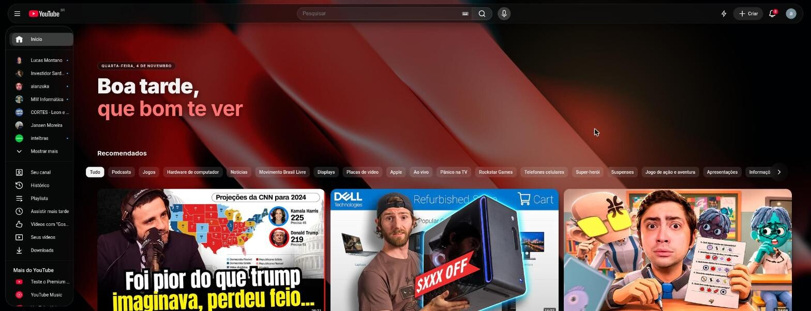
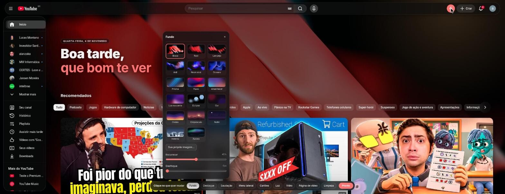

# Vitro — YouTube in glass

**English** | [Português](README.pt-BR.md)

A Chrome/Brave extension that makes YouTube feel modern: floating glass bars, your own wallpaper, a greeting on the home page, translucent cards and zero Shorts. Available in **English and Portuguese**.



> 🤖 A *vibecoded* project: built in conversation with **Claude Opus** (Anthropic) in Claude Code, starting from screenshots and an analysis of a theme extension I used to pay for.

## Install (developer mode)

1. Open `chrome://extensions` (or `brave://extensions`).
2. Turn on **Developer mode** (top right).
3. Click **Load unpacked** and pick this folder.
4. Open YouTube (preferably in the **dark theme**) and reload the tab.

> Disable other YouTube theme extensions while testing; they fight over the same CSS.

After editing the code, click ↻ on the extension card and reload the YouTube tab.

## Features

| Area | What it does |
|---|---|
| **Glass** | Floating pill-shaped top bar, sidebar and mini sidebar as glass panels. Glass / Frosted / Solid styles, adjustable blur and transparency. |
| **Background** | 11 image wallpapers (default: **Ember**) + 6 generated SVG scenes, or your own image. Dim and blur controls. |
| **Highlight** | Time-based greeting ("Good morning / Good afternoon / Good evening") with the date, your name in an accent color, optional snow. |
| **Cards** | Translucent background, 18px corners, shadow, hover animation. Title below/over the thumbnail, text size, layout (Default/Airy/Dense), feed width, borders. |
| **Light** | A glow that follows the cursor over the wallpaper, with darkness around it. |
| **Video page** | "Movie theater": the background becomes the video itself, blurred; description and comments sit in glass panels. |
| **Cleanup** | No Shorts (also redirects `/shorts/ID` to `/watch?v=ID`), hidden and skipped ads, optional recommendations, no end screens, no merch. |
| **Dark theme** | Forces YouTube's dark palette even if your account uses the light theme (on by default; turning it off restores the original). |
| **Language** | English and Portuguese. Follows the browser language or can be picked in the popup. |

## Usage

- Click the **lightning bolt** ⚡ in YouTube's top bar to open the visual editor, a floating glass card you can drag around. Pick an area (Background, Highlight, Greeting…) and tweak it live. `Esc` or **Done** closes it.



- The extension icon opens a popup with the main switches and the **Language** selector (Automatic / English / Português).
- Settings live in `chrome.storage.sync` (they follow your account); your own image lives in `chrome.storage.local`.

## Languages

- Extension strings live in `src/i18n.js` (`en` and `pt` objects with the same keys). The extension name and description live in `_locales/` (Chrome's standard).
- **Automatic** uses `pt` when the browser is set to any Portuguese variant and `en` otherwise.
- To add a language: add a new object in `src/i18n.js`, update `vitroLang`/`vitroLocale`, add the option to the `<select>` in `popup/popup.html`, and add a folder under `_locales/`.

## Tests

```sh
npm install        # only @playwright/test; no browser download
npm test           # unit tests (node:test, no browser)
npm run test:e2e   # end-to-end: loads the extension in Chromium
npm run test:all   # both
```

- **Unit** (`tests/unit/`): pure logic in `src/core.js` (classes, CSS variables, greeting, routes, Shorts redirect, wallpaper choice), settings sanitizing, EN/PT dictionary parity and coverage, and package integrity (manifest files, locales, wallpapers, CSS, changelog). Includes a regression test for the v1.1.0 hero bug.
- **E2E** (`tests/e2e/`): launches the system Chromium (`CHROMIUM_PATH`, default `/usr/bin/chromium`) with Vitro loaded and serves a fake YouTube page in place of `https://www.youtube.com/` via request interception, so it never touches the real site. Covers theme, glass, Shorts/ads hiding, greeting layout and alignment, forced dark theme, editor, persistence, popup, language switching, Shorts redirect, video page and ad skipping.
- `HEADED=1 npm run test:e2e` shows the browser.

## Versions

The current version lives in `manifest.json` (shown in the popup and in `brave://extensions`), and the history in [CHANGELOG.md](CHANGELOG.md) (in Portuguese). Every release has a GPG-signed git tag `vX.Y.Z`.

Release flow:

1. Write the changes under `## [Não lançado]` (Unreleased) in `CHANGELOG.md` and commit.
2. Run the script with the kind of change:

```sh
scripts/release.sh patch   # bug fix          1.2.0 → 1.2.1
scripts/release.sh minor   # new feature      1.2.0 → 1.3.0
scripts/release.sh major   # breaks settings  1.2.0 → 2.0.0
scripts/release.sh zip     # only builds dist/vitro-vX.Y.Z.zip for the current version
```

The script bumps the manifest version, closes the changelog section with the date, creates the `release: vX.Y.Z` commit, the tag, and the `.zip` in `dist/` (git-ignored).

## Project layout

```
manifest.json        MV3
_locales/            extension name and description (en, pt_BR)
src/settings.js      defaults + load/save/sanitize
src/core.js          pure logic (tested)
src/i18n.js          EN/PT dictionary and language selection
src/wallpapers.js    wallpaper list (images + generated SVG)
src/content.js       <html> classes, background layers, greeting, theater, editor, ad skipping
src/vitro.css        all the styling (scoped under html.vt-*)
popup/               extension popup
wallpapers/          original images (source)
assets/wallpapers/   optimized images used by the extension (2560px, JPEG)
assets/thumbs/       editor thumbnails
docs/                README images
tests/unit/          node:test
tests/e2e/           Playwright + fake YouTube
scripts/release.sh   versioning (bump + tag + zip)
CHANGELOG.md         version history
icons/               icon (SVG → PNG via rsvg-convert)
```

## Wallpapers

Ember, Ruby, Flash, Indigo, Blue neon, Ocean, Prism, Flow, Dawn, Moonrise and Eclipse, plus the SVG scenes Color, Waves, Dusk, Night, Winter and Aurora. (Their file ids are in Portuguese: `brasa`, `rubi`, `lampejo`, `anil`, `neon-azul`, `oceano`, `prisma`, `fluxo`, `amanhecer`, `lua-nascente`, `eclipse`.)

To add one: drop the image in `wallpapers/`, build the optimized versions, register the id in `IMAGES` inside `src/wallpapers.js`, and add its name as `wall.<id>` in both languages in `src/i18n.js`:

```sh
n=my-wallpaper
magick wallpapers/$n.png -resize '2560x2560>' -strip -quality 82 assets/wallpapers/$n.jpg
magick wallpapers/$n.png -resize 240x135^ -gravity center -extent 240x135 -strip -quality 75 assets/thumbs/$n.jpg
```

"Ocean" is a photo by Richard Horvath on [Unsplash](https://unsplash.com/).

## Limitations

- Ad blocking is cosmetic, plus skipping/fast-forwarding video ads. It is not a network blocker like uBlock Origin; use both together if you want.
- YouTube changes its DOM often. If something breaks, the selectors are concentrated in `src/vitro.css`.
