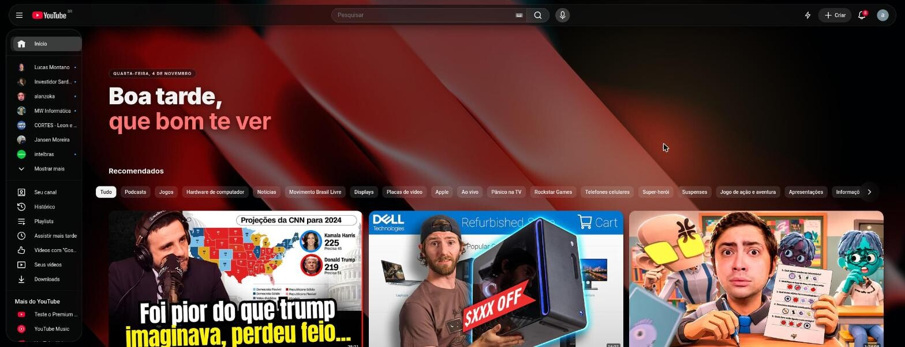
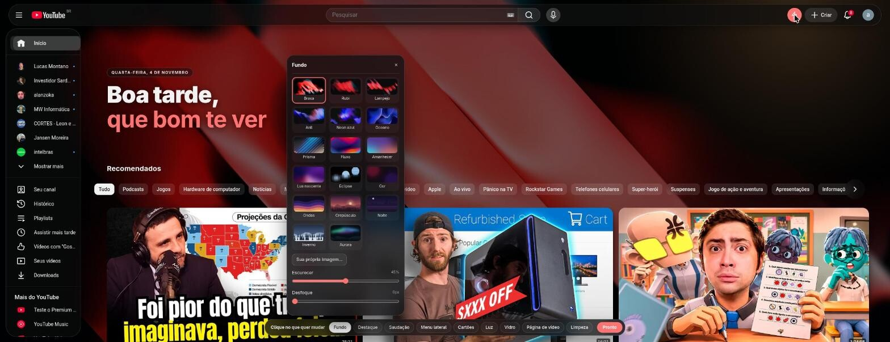

# Vitro — YouTube em vidro

[English](README.md) | **Português**

Extensão para Chrome/Brave que deixa o YouTube moderno: barras de vidro flutuantes, seu papel de parede, saudação na home, cartões translúcidos e zero Shorts. Disponível em **inglês e português**.



> 🤖 Projeto *vibecoded*: construído em conversa com o **Claude Opus** (Anthropic) no Claude Code, a partir de prints e da análise de uma extensão de tema que eu usava.

## Instalar (modo desenvolvedor)

1. Abra `chrome://extensions` (ou `brave://extensions`).
2. Ative **Modo do desenvolvedor** (canto superior direito).
3. Clique em **Carregar sem compactação** e escolha esta pasta.
4. Abra o YouTube (de preferência no **tema escuro**) e recarregue a aba.

> Desative outras extensões de tema do YouTube enquanto testa; elas brigam pelo mesmo CSS.

Depois de editar o código, clique em ↻ no card da extensão e recarregue a aba do YouTube.

## O que faz

| Área | Recursos |
|---|---|
| **Menu lateral** | Escolha quais itens e seções aparecem: inscrições, histórico, playlists, assistir mais tarde, curtidos, seus vídeos, downloads, "Mais do YouTube", Explorar, configurações e rodapé. |
| **Interface** | Fontes embutidas (Inter, Manrope, Outfit), do sistema ou a do YouTube; escala da página (85–120%); sons suaves opcionais. |
| **Vidro** | Barra superior em pílula flutuante, menu lateral e mini-menu em painéis de vidro. Estilos Vidro / Fosco / Sólido, desfoque e transparência ajustáveis. |
| **Fundo** | 11 papéis de parede em imagem (padrão: **Brasa**) + 6 cenas em SVG gerado, ou sua própria imagem. Modos: fixo, **dia e noite** (troca às 18h / 6h), **um por dia** ou **um por aba**. **Prévia ao passar o mouse**. Escurecer e desfoque. |
| **Destaque** | Saudação por horário ("Bom dia / Boa tarde / Boa noite") com data, seu nome em cor de destaque, neve opcional. |
| **Cartões** | Fundo translúcido, cantos de 18px, sombra, animação ao passar o mouse. Título sob/sobre a imagem, tamanho do texto, disposição (Padrão/Ar/Denso), largura do feed, bordas. |
| **Luz** | Halo que segue o cursor sobre o papel de parede, com escuridão ao redor. |
| **Página de vídeo** | "Sala de cinema": o fundo vira o próprio vídeo desfocado; descrição e comentários em painéis de vidro. |
| **Limpeza** | Sem Shorts (inclusive redireciona `/shorts/ID` para `/watch?v=ID`), anúncios escondidos e pulados, recomendados opcionais, sem telas finais, sem merch. |
| **Tema escuro** | Força a paleta escura do YouTube mesmo com a conta no tema claro (ligado por padrão; desligar devolve o original). |
| **Idioma** | Inglês e português. Segue o idioma do navegador ou pode ser escolhido no popup. |

## Como usar

- Clique no **raio** ⚡ na barra superior do YouTube para abrir o editor visual, um card de vidro flutuante que dá para arrastar. Escolha a área (Fundo, Destaque, Saudação…) e ajuste ao vivo. `Esc` ou **Pronto** fecha.



- O ícone da extensão abre um popup com os interruptores principais e o seletor de **Idioma** (Automático / English / Português).
- Configurações ficam em `chrome.storage.sync` (seguem sua conta); a imagem própria fica em `chrome.storage.local`.

## Idiomas

- Os textos da extensão ficam em `src/i18n.js` (objetos `en` e `pt`, com as mesmas chaves). O nome e a descrição da extensão ficam em `_locales/` (padrão do Chrome).
- **Automático** usa `pt` quando o navegador está em qualquer variante de português, e `en` nos outros casos.
- Para adicionar um idioma: crie um objeto novo em `src/i18n.js`, ajuste `vitroLang`/`vitroLocale`, adicione a opção no `<select>` do `popup/popup.html` e uma pasta em `_locales/`.

## Testes

```sh
npm install        # só o @playwright/test; não baixa navegador
npm test           # unitários (node:test, sem navegador)
npm run test:e2e   # ponta a ponta: carrega a extensão no Chromium
npm run test:all   # os dois
```

- **Unitários** (`tests/unit/`): lógica pura do `src/core.js` (classes, variáveis CSS, saudação, rotas, redirecionamento de Shorts, escolha do wallpaper), limpeza das configurações salvas, paridade e cobertura do dicionário EN/PT e integridade do pacote (arquivos do manifest, locales, wallpapers, CSS, changelog). Inclui teste de regressão do bug da saudação da v1.1.0.
- **E2E** (`tests/e2e/`): abre o Chromium do sistema (`CHROMIUM_PATH`, padrão `/usr/bin/chromium`) com o Vitro carregado e serve uma página falsa do YouTube no lugar de `https://www.youtube.com/` por interceptação de rede, sem tocar no site real. Cobre tema, vidro, Shorts/anúncios escondidos, posição e alinhamento da saudação, tema escuro forçado, editor, persistência, popup, troca de idioma, redirecionamento de Shorts, página de vídeo e pulo de anúncio.
- `HEADED=1 npm run test:e2e` mostra o navegador.

## Versões

A versão atual fica no `manifest.json` (aparece no popup e em `brave://extensions`) e o histórico no [CHANGELOG.md](CHANGELOG.md). Cada versão lançada tem uma tag git `vX.Y.Z` assinada com GPG.

Fluxo para lançar:

1. Anote as mudanças na seção `## [Não lançado]` do `CHANGELOG.md` e commite.
2. Rode o script com o tipo da mudança:

```sh
scripts/release.sh patch   # correção        1.2.0 → 1.2.1
scripts/release.sh minor   # recurso novo    1.2.0 → 1.3.0
scripts/release.sh major   # quebra config.  1.2.0 → 2.0.0
scripts/release.sh zip     # só gera dist/vitro-vX.Y.Z.zip da versão atual
```

O script sobe a versão no manifest, fecha a seção do changelog com a data, cria o commit `release: vX.Y.Z`, a tag e o `.zip` em `dist/` (fora do git).

## Estrutura

```
manifest.json        MV3
_locales/            nome e descrição da extensão (en, pt_BR)
src/settings.js      padrões + load/save/limpeza
src/core.js          lógica pura (testada)
src/i18n.js          dicionário EN/PT e escolha de idioma
src/wallpapers.js    lista de papéis de parede (imagens + SVG gerado)
src/content.js       classes no <html>, camadas de fundo, saudação, sala, editor, pulo de anúncio
src/vitro.css        todo o visual (escopado em html.vt-*)
popup/               popup da extensão
wallpapers/          imagens originais (fonte)
assets/wallpapers/   imagens otimizadas usadas pela extensão (2560px, JPEG)
assets/thumbs/       miniaturas do editor
assets/fonts/        fontes embutidas (OFL)
docs/                imagens do README
tests/unit/          node:test
tests/e2e/           Playwright + YouTube falso
scripts/release.sh   versionamento (bump + tag + zip)
CHANGELOG.md         histórico de versões
icons/               ícone (SVG → PNG via rsvg-convert)
```

## Papéis de parede

Brasa, Rubi, Lampejo, Anil, Neon azul, Oceano, Prisma, Fluxo, Amanhecer, Lua nascente e Eclipse, além das cenas em SVG Cor, Ondas, Crepúsculo, Noite, Inverno e Aurora.

Para adicionar um novo: coloque a imagem em `wallpapers/`, gere as versões otimizadas, registre o id em `IMAGES` dentro de `src/wallpapers.js` e o nome em `wall.<id>` nos dois idiomas de `src/i18n.js`:

```sh
n=meu-fundo
magick wallpapers/$n.png -resize '2560x2560>' -strip -quality 82 assets/wallpapers/$n.jpg
magick wallpapers/$n.png -resize 240x135^ -gravity center -extent 240x135 -strip -quality 75 assets/thumbs/$n.jpg
```

"Oceano" é uma foto de Richard Horvath no [Unsplash](https://unsplash.com/).

As fontes Inter, Manrope e Outfit vêm embutidas sob a SIL Open Font License 1.1 (veja `assets/fonts/`).

## Roadmap

Ideias para as próximas versões, mais ou menos em ordem de prioridade. Sugestões são bem-vindas.

### Próximos passos
- [ ] **Temas prontos (presets)** — um clique aplica um visual completo (*Minimal*, *Cinema*, *Foco*, *Neon*); salvar suas combinações com nome.
- [ ] **Cor de destaque automática** — tirada da cor dominante do papel de parede.
- [ ] **Desfazer e restaurar por seção** — botão ↺ em cada seção e `Ctrl+Z` para o último ajuste.
- [ ] **Exportar / importar configurações** — código ou arquivo para levar o visual a outro PC ou compartilhar.
- [ ] **Atalho de teclado** — abrir/fechar o editor com `Alt+V`.

### Foco e bem-estar
- [ ] **Modo Foco** — esconde o feed da home, deixa só busca e inscrições.
- [ ] **Esconder números** — views, likes e inscritos.
- [ ] **Esconder comentários** por padrão, com botão para mostrar.
- [ ] **Esconder vídeos já assistidos** do feed.
- [ ] **Bloquear canais ou palavras** nos títulos.
- [ ] **Lembrete de pausa / tempo assistido hoje**, na saudação.

### Player
- [ ] **Velocidade e qualidade padrão** (ex.: sempre 1.25× e 1080p).
- [ ] **Modo cinema automático** ao abrir um vídeo.
- [ ] **Captura de quadro** — salva um print do frame atual.
- [ ] **Botão de Picture-in-Picture** sempre visível.
- [ ] **Pular patrocínios (SponsorBlock)** — exige API externa e permissão nova.

### Usabilidade do editor
- [ ] **Busca de opções** — digitar "neve" ou "transparência" e ir direto ao controle.
- [ ] **Prévia antes/depois** — segurar um botão para ver o YouTube original.
- [ ] **Seção de acessibilidade** — reduzir animações, alto contraste, foco mais visível.

## Limitações

- O bloqueio de anúncios é cosmético + pula/acelera o anúncio em vídeo. Não é um bloqueador de rede como o uBlock Origin; use os dois juntos se quiser.
- O YouTube muda o DOM com frequência. Se algo quebrar, os seletores estão concentrados em `src/vitro.css`.
